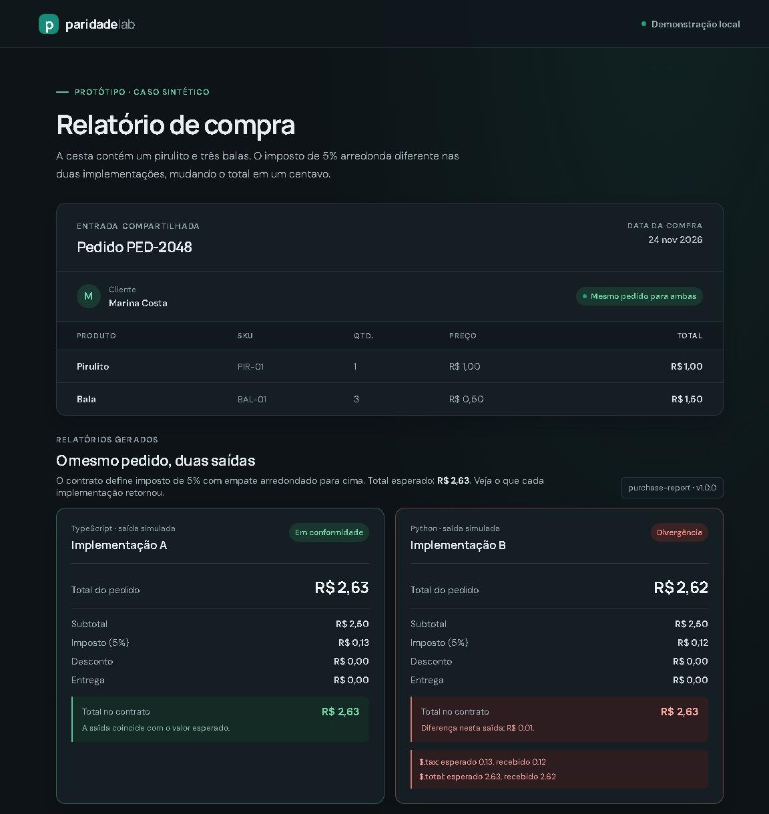

# Cross-language parity: the missing center

### A market study of tools that prove two implementations agree

**Research preview — November 2026.**

Two implementations of the same contract drift silently. A tokenizer difference, a locale-sensitive
lowercase, a rounding rule or a tie-break order does not throw. It returns a slightly different answer, in
one language, for some inputs.

This study maps the public tools that claim to prove implementations agree — differential testing, API
contract testing, SDK generation, standards conformance suites and internal parity harnesses — and finds
the part that is missing.

**[Read the study →](study.md)**

## The short version

- Differential testing is a 1998 technique; cross-language conformance suites are standard.
- Strong tools cover API schemas and protocols; they do not compare algorithm outputs.
- The direct generic CLI tools are early or abandoned; teams rebuild the harness internally.
- The gap is not a missing category; it is a missing center: a contract-first, open-source CLI for
  algorithmic parity.

## Demo: one cent of rounding drift

The synthetic basket contains one lollipop and three candies (R$ 2.50 total). A 5% tax produces
R$ 0.125 before rounding. The contract rounds positive ties up to cents: the TypeScript example
returns R$ 0.13, while Python's built-in `round` uses ties-to-even and returns R$ 0.12. The order
totals therefore differ by one cent, even though both examples pass the same ordinary R$ 2.00 test.

  

**[Open the interactive demo →](https://steinantonio.github.io/cross-language-parity-study/)**

This is a proof-of-concept, not the V1 product. Its CLI compares pre-recorded, language-neutral JSON
outputs; it does not execute TypeScript or Python workers. The code snippets and outputs are
illustrative.

Run locally with `cd demo && npm install && npm run dev`. To run the fixture through the CLI, use
`npm run parity:demo` from `demo/`; this example intentionally exits with status `1` because the
Python output differs from the contract.

## What the study covers

| Section | What it answers |
|---|---|
| Landscape | Eight categories, from generic diff CLIs to correctness platforms |
| Strong tools | Why Specmatic, PactFlow, Speakeasy, MCP conformance and Antithesis solve a different problem |
| Direct tools | `difftest` (0★, last push April 2026) and `serify` (2★) |
| Demand | cognee, HelixDB, Ably, Conduit, Flagsman, hgraph, GoldenMatch |
| Prior art | McKeeman 1998, Csmith, JSON Schema, Protobuf, Autobahn, MCP |
| The gap | Why "missing category" is the wrong frame; "missing center" is the right one |
| Limits | What the study does not prove, and what we must not claim |

## Who this is for

- Platform teams that ship two or more SDKs.
- MCP server authors with a Python reference and a TypeScript or .NET port.
- Teams porting a library with an LLM.
- Maintainers of pricing, risk, scoring or ranking engines.
- Anyone who has said: "it compiles, the tests pass, but the numbers differ."

## What this study does not prove

- It does not prove demand. It shows public artifacts and documented internal harnesses.
- It does not measure private tools inside companies.
- It does not claim correctness. Parity is agreement with a contract, not truth.

## Call for interviews

If you maintain two implementations of the same contract, I would like to talk for 20 minutes. I am looking
for the cases where the divergence was silent: it compiled, the tests passed, and the behavior still
differed.

Open an issue with the **Share your case** template, or send a message with:

- the two implementations and the contract between them;
- the kind of output that must match;
- what you use today to check it;
- what fails silently.

## Status

- **Research preview:** published.
- **Demo:** synthetic proof-of-concept; it illustrates the gap but is not the V1 implementation.
- **Implementation:** private for now; it will be linked here when the V1 is ready.
- **Corrections:** welcome via issue or pull request.

## Cite this study

> Stein, A. (2026). *The missing center of cross-language parity: a market study of tools that prove two
> implementations agree.* https://github.com/Steinantonio/cross-language-parity-study

## Author

Antonio Stein — [@Steinantonio](https://github.com/Steinantonio)

## License

Text: [CC BY 4.0](LICENSE). You may share and adapt with attribution.

---

**Read the full study:** [The missing center of cross-language parity](study.md)
